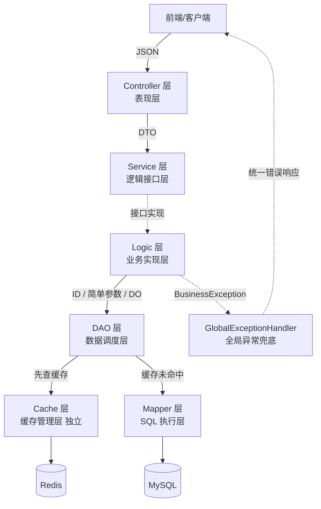

# ApexSports · 顶点体育（后端）

> 基于冲突检测与约束校验的高校赛事管理系统 

**ApexSports（顶点体育）** 是 [Apex 系列](https://blog.fanfan187.cn)的后端核心项目。项目以「高校运动会及复杂体育赛事」为真实业务载体，**针对多维赛程编排中的场地冲突、时间互斥与积分并发等核心痛点**，深度实践并验证了一套面向**高内聚、职责严格收敛**的后端六层分层架构规范。

🔗 配套前端项目：[ApexSportsWeb](https://github.com/fanfan187/ApexSportsWeb)

📝 分层架构的设计思路、每层职责边界与红线，完整走读见博客：[从分层混乱到职责分明：一套后端架构规范的完整走读](https://blog.fanfan187.cn/posts/c9b03e21.html)

---

## 🏗️ 架构总览

核心调用链路：

```
Controller → Service(接口) → Logic(实现) → DAO → Mapper + Cache
```

| 层 | 一句话职责 |
|---|---|
| **Controller** | 接收 HTTP 请求、参数校验、DTO ↔ JSON 转换、封装统一响应 `Result<VO>` |
| **Service** | 只定义接口契约（`services/` 包内只有接口，没有实现） |
| **Logic** | 业务判断、跨 DAO 编排、事务边界（`@Transactional`）、DO → VO 转换 |
| **DAO** | 数据调度：决定从缓存还是数据库取数；写操作负责缓存失效 |
| **Cache** | Redis Key 格式、TTL、序列化方式私有化，按实体划分，对外只暴露业务语义方法 |
| **Mapper** | 继承 MyBatis-Plus `BaseMapper` 执行 SQL，复杂查询写在 XML |

几条贯穿全局的约束：
1. **Redis 从未暴露给 Logic 层**：缓存一致性在 DAO 内部闭环，且驱逐推迟到事务提交后执行，见 `CacheEvictionUtil#evictAfterCommit`；
2. **DO 永不离开数据层**：`entities/` 不出现在 Controller 返回值中，VO 脱敏后返回；
3. **全局异常与业务错误码体系**：业务异常统一由 Logic 抛出 `BusinessException` + `ErrorCode`，由 `GlobalExceptionHandler` 兜底转成统一响应。

### 业务与数据流转架构



---

## 📂 目录结构

```
src/main/java/com/fanfan/apexsports/
├── controllers/          # Controller 层（表现层）
├── services/             # Service 接口层（只有接口，没有实现）
├── logic/                # Logic 实现层（业务编排 + 事务边界）
├── daos/                 # DAO 数据调度层（缓存 ↔ 数据库调度）
├── cache/                # Cache 缓存管理层（Key/TTL/序列化私有化，独立包）
├── mappers/              # Mapper SQL 执行层（MBP BaseMapper + 自定义 XML）
├── entities/             # DO 数据库映射对象（不外抛）
├── dtos/                 # DTO 请求传输对象
├── vos/                  # VO 视图响应对象（脱敏后返回前端）
├── common/result/        # 统一响应 Result / PageResult
├── config/               # 配置（JWT 拦截器、Redis、MyBatis-Plus、UserContext 等）
├── constants/            # 常量定义
├── exception/            # BusinessException / ErrorCode / GlobalExceptionHandler
└── utils/                # 工具（JwtUtil、CacheEvictionUtil）
src/main/resources/
├── application.yml       # 配置文件
└── mapper/               # 复杂查询 XML（联表、分组、排序）
```

---

## 🛠️ 技术栈

| 类别 | 技术 | 版本 |
|---|---|---|
| 语言 | Java | 17 |
| 核心框架 | Spring Boot | 3.4.4 |
| ORM | MyBatis-Plus | 3.5.5 |
| 数据库 | MySQL | 8.0 |
| 连接池 | Druid | 1.2.23 |
| 缓存 | Redis + Lettuce | 7.2 |
| 分布式锁 | Redisson | 3.27.0 |
| 认证 | JWT (jjwt) | 0.12.5 |
| API 文档 | SpringDoc OpenAPI 3 + Knife4j | 2.5.0 / 4.5.0 |
| 工具库 | Lombok / MapStruct / Hutool | - |

---

## 📦 核心业务与高可靠机制

围绕高校运动会复杂业务，共实现 15 个 Controller、17 组 Service/Logic，重点解决了多维并发冲突与数据一致性问题：

- 🔐 **认证授权与安全防护**：基于 JWT 状态鉴权，结合 Redis 实现 Token 黑名单即时失效机制与细粒度密码修改流转。
- 🎓 **多角色/学院基础信息**：用户、学院、运动员、裁判、场地与器材的全生命周期管理。
- 🏅 **赛事规则与校记录体系**：灵活支持个人/集体、径赛/田赛规则定义，支持全校历史记录自动化关联与维护。
- 📋 **赛程编排与冲突检测（核心痛点突破）**：
  - **场地时段防重**：自动化校验同一场地在指定时间段内的占用互斥；
  - **裁判资源分配**：裁判防撞期校验与主裁判唯一性约束；
  - **器材依赖调度**：基于赛事规模的动态器材分配与状态追踪。
- ✍️ **报名系统与强约束校验**：个人/集体报名多重业务约束（项目报名次数上限、性别严格匹配、重复报名防重等拦截逻辑）。
- 🥇 **得分统计与高并发一致性保障**：
  - **批量成绩录入**：径赛/田赛多维度成绩录入与排名自动化换算；
  - **学院积分并发更新**：集成 **Redisson 分布式互斥锁**，保障大批量成绩录入时学院积分汇总的安全刷新；
  - **事务后缓存失效机制**：通过 `CacheEvictionUtil#evictAfterCommit` 实现 Spring 事务提交后精准淘汰缓存，杜绝脏读。
- 📊 **数据看板**：多维度 Dashboard 实时聚合分析与赛事大屏数据支撑。

### 数据模型

共 15 张表，完整建表语句见 [init/schema.sql](init/schema.sql)：

`as_user` / `as_college` / `as_athlete` / `as_referee` / `as_venue` / `as_equipment` / `as_event` / `as_competition` / `as_participation` / `as_team_participation` / `as_referee_assignment` / `as_competition_equipment` / `as_score` / `as_record` / `as_college_score_summary`

---

## 🚀 快速开始

### 环境要求

- JDK 17+
- Maven 3.6+
- Docker & Docker Compose（推荐，用于一键启动 MySQL + Redis）

### 1. 启动数据库与缓存

```bash
docker compose up -d
```

`docker-compose.yml` 会启动：

- **MySQL 8.0**（端口 3306，库名 `apex_sports`，账号 `sports_user` / `123456`）
- **Redis 7.2**（端口 6379，开启 AOF 持久化）

首次启动会自动执行 `init/schema.sql`（建表）与 `init/data.sql`（初始化基础数据，含管理员账号）。

### 2. 启动应用

```bash
mvn spring-boot:run
```

### 3. 验证

- 服务地址：`http://localhost:8080/api`
- 接口文档（Knife4j）：`http://localhost:8080/api/doc.html`
- Swagger UI：`http://localhost:8080/api/swagger-ui.html`

### 配置说明

| 配置项 | 默认值 | 说明 |
|---|---|---|
| `server.port` | `8080` | 服务端口 |
| `server.servlet.context-path` | `/api` | 统一接口前缀 |
| `spring.datasource.*` | `localhost:3306/apex_sports` | MySQL 连接 |
| `spring.data.redis.*` | `localhost:6379` | Redis 连接 |
| `apex.jwt.secret` | 环境变量 `APEX_JWT_SECRET` | JWT 签名密钥（生产环境务必通过环境变量覆盖） |
| `apex.jwt.expiration` | `7200000`（2 小时） | Token 有效期 |

---

## 🔗 相关链接

- [架构规范走读博客](https://blog.fanfan187.cn/posts/c9b03e21.html)
- [配套前端项目 ApexSportsWeb](https://github.com/fanfan187/ApexSportsWeb)

---

## 👤 作者

**翻翻 (fanfan187)** —— [博客：杜松子酒](https://blog.fanfan187.cn) | [GitHub](https://github.com/fanfan187)
